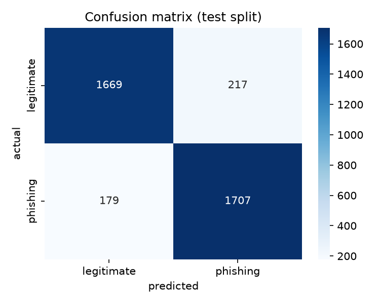
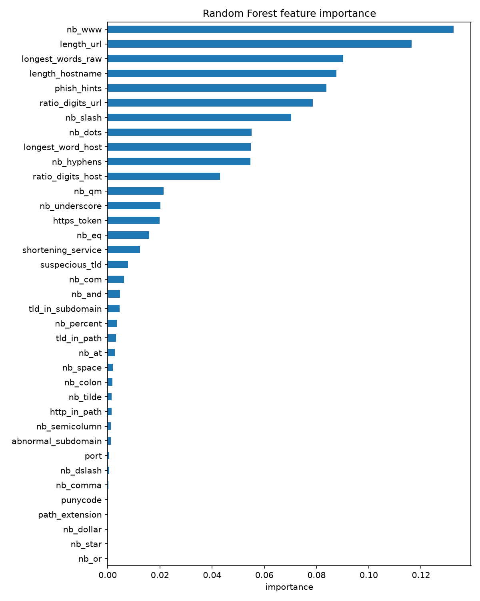

# PhishCheck

*Phishing Website URL Detection Using Machine Learning*

The core idea: a URL can be inspected offline, without fetching the page, without WHOIS/DNS lookups, and without sending data anywhere. Every feature used by the model is recomputed from the raw URL text with pure Python, and every one of them has been **verified against the official dataset values (≥99% exact match)** before being accepted into the model.

## Project Status (temporary section — will be removed once development finishes)

| Stage | Deliverable                                                             | Status                                                                                                        |
| ----- | ----------------------------------------------------------------------- | ------------------------------------------------------------------------------------------------------------- |
| 1     | `src/ml/url_features.py` — feature extraction + verification harness | **Done** — 37/37 features verified ≥99% on the official train split; `feature_columns.json` written |
| 2     | `train_model.py` — train Random Forest, evaluate, save model + plots | **Done** — test accuracy 0.8950, F1 0.8961; `phishing_model.pkl` + 3 plots saved                     |
| 3     | `app.py` — Streamlit UI for single-URL prediction                    | **Done** — predict path + headless launch verified                                                     |
| 4     | README final polish                                                     | **Done** — assignment report skipped by decision                                                       |

Notes on current state:

- All stages complete. Measured metrics are in the [Results](#results) section — copied exactly from the training run, never estimated.
- Stage 1 detail: 13 URL-syntax features could not be reproduced at ≥99% fidelity and were **dropped**, not approximated. Page-content and external-service features are permanently out of scope.

## Tech Stack

| Layer                                | Choice                                                                                            |
| ------------------------------------ | ------------------------------------------------------------------------------------------------- |
| Language                             | Python ≥ 3.12                                                                                    |
| Environment / package manager        | [uv](https://docs.astral.sh/uv/) (`pyproject.toml`, `uv.lock`, generated `requirements.txt`) |
| Data handling                        | pandas + pyarrow (HF Parquet files)                                                               |
| Dataset hosting                      | Hugging Face Datasets —`pirocheto/phishing-url` via `huggingface_hub`                        |
| Model                                | scikit-learn`RandomForestClassifier` (`random_state=42`)                                      |
| Plots                                | matplotlib + seaborn                                                                              |
| Web app                              | Streamlit                                                                                         |
| Deep learning / tuning / comparisons | intentionally none — single algorithm, single train/test protocol                                |

## Dataset

| Property              | Value                                                                                                                                                                                                |
| --------------------- | ---------------------------------------------------------------------------------------------------------------------------------------------------------------------------------------------------- |
| Source                | Hugging Face dataset[`pirocheto/phishing-url`](https://huggingface.co/datasets/pirocheto/phishing-url)                                                                                              |
| Splits used           | Official`train.parquet` (7,658 rows) and `test.parquet` (3,772 rows) — **never re-split, never cross-validated**                                                                          |
| Columns               | 89 total:`url` (raw string), `status` (target: `phishing` / `legitimate`), and 87 numeric feature columns                                                                                    |
| Target                | `status` — `phishing` vs `legitimate`, perfectly balanced (train: 3,829 / 3,829)                                                                                                              |
| Usage in this project | Features are recomputed from`url`; the stored feature columns are only used to **verify** the extraction code. The test split is used only for final evaluation, never for design decisions. |

The 87 stored feature columns break down exactly as:

1. **37 URL-syntax features used by this project** — computable from the URL text alone (verified, see below).
2. **13 URL-syntax features attempted and dropped** — could not be reproduced at ≥99% fidelity.
3. **37 features out of scope** — page-content features (hyperlinks, forms, iframe, titles, …), external-service features (WHOIS, DNS, page rank, traffic, google index, …), and a few columns that need the page or brand lists anyway (`nb_redirection`, `domain_in_brand`, `statistical_report`, …).

## Features

37 features are used, all recomputable from the URL string alone. Each one is a pure function of the raw URL, and each matched its stored dataset value on ≥99% of train rows (measured range 99.37%–100%, printed by the verification harness).

**Lengths & character counts (in the raw URL)**

`length_url`, `length_hostname`, `nb_dots`, `nb_hyphens`, `nb_at`, `nb_qm`, `nb_and`, `nb_or`, `nb_eq`, `nb_underscore`, `nb_tilde`, `nb_percent`, `nb_slash`, `nb_star`, `nb_colon`, `nb_comma`, `nb_semicolumn`, `nb_dollar`, `nb_space` (percent-decoded spaces), `nb_www`, `nb_com` (case-insensitive, adjusted for the host's last two labels), `nb_dslash`

**Scheme & host**

`https_token` (1 when the scheme is plain `http`), `http_in_path` (`http` token inside path/query), `port`, `punycode` (`xn--` in host), `ratio_digits_url`, `ratio_digits_host`

**Domain & TLD structure**

`tld_in_path` (host TLD reappears in path/query), `tld_in_subdomain` (TLD label inside the subdomain region), `abnormal_subdomain` (numeric/odd prefixes in subdomains or IP host), `suspecious_tld` (suspicious TLD, with second-level context such as `go.id` / `gob.pe`), `shortening_service` (known URL-shortener host)

**Path & words**

`path_extension` (last path segment ends in `.txt`/`.csv`/`.log`), `longest_words_raw` (longest token in the scheme-less URL), `longest_word_host` (longest token in the host), `phish_hints` (count of hint words such as `login`, `admin`, `verify`, `paypal`)

The full canonical order lives in `feature_columns.json` (generated by the harness); the training script and the app must build the model input in exactly this order.

**Excluded on purpose**

- 37 stored columns (page-content / external-service / redirect & brand columns) — cannot be recomputed from a URL offline.
- The 13 URL-syntax candidates listed above — attempted and dropped because they could not be reproduced at ≥99%: `ip`, `prefix_suffix`, `nb_subdomains`, `char_repeat`, `random_domain`, `length_words_raw`, `shortest_words_raw`, `avg_words_raw`, `shortest_word_host`, `avg_word_host`, `shortest_word_path`, `longest_word_path`, `avg_word_path`.

## Results

Measured on the official test split (3,772 rows), positive class = `phishing`:

| Metric    | Value  |
| --------- | ------ |
| Accuracy  | 0.8950 |
| Precision | 0.8872 |
| Recall    | 0.9051 |
| F1        | 0.8961 |

Confusion matrix (rows = actual, columns = predicted):

|                             | predicted legitimate | predicted phishing |
| --------------------------- | -------------------- | ------------------ |
| **actual legitimate** | 1669                 | 217                |
| **actual phishing**   | 179                  | 1707               |





Model: `RandomForestClassifier` with sklearn defaults and `random_state=42` — no hyperparameter tuning or cross-validation, by assignment design.

### Reading these numbers

- **3,376 of 3,772** test URLs classified correctly (89.5%).
- **Recall 90.5%** — about 9 of every 10 phishing URLs are caught.
- **Precision 88.7%** — when the model says "phishing", it is right about 9 times in 10.
- The two error types differ in cost: **217 false alarms** (a safe site flagged as phishing — the cautious direction) versus **179 misses** (a phishing site passed as safe — the costly direction).
- Errors appear where syntax alone is ambiguous — e.g. short bare domains flagged as suspicious, or complex-but-legitimate paths raising risk signals.
- Page-content and WHOIS/DNS features would resolve much of this ambiguity, but they are permanently out of scope by design: only features recomputable from a raw URL are allowed. These figures are the honest result of that scope, not a tuning shortfall.

## Limitations

- Only URL-syntax features are used: page-content (hyperlinks, forms, iframe) and external-service (WHOIS, DNS, page rank, traffic) features cannot be computed from a raw URL and are permanently out of scope.
- 13 URL-syntax features could not be reproduced at ≥99% fidelity against the stored dataset values and were dropped rather than approximated.
- RandomForest runs with sklearn defaults — no tuning or model comparisons, per the single-algorithm constraint.
- The original dataset's feature-extraction source is unavailable; all feature definitions were reconstructed empirically and verified against the stored values.

## How to Use

### Prerequisites

- [git](https://git-scm.com/)
- [uv](https://docs.astral.sh/uv/) — installs and manages Python 3.12 automatically, no manual Python setup

### 1. Clone the repository

```bash
git clone https://github.com/jsfl-24/phishcheck.git
cd ML
```

### 2. Install dependencies

```bash
uv sync
```

### 3. Verify the feature extraction (Stage 1 deliverable)

```bash
uv run python -m ml.url_features
```

Prints a per-feature table (feature, best variant, exact-match rate on the 7,658 train rows, KEEP/DROP verdict) and (re)writes `feature_columns.json`. Any feature below 99% must be fixed or dropped — never approximated.

### 4. Train the model

```bash
uv run python train_model.py
```

Trains a `RandomForestClassifier` (`random_state=42`) on the official train split, evaluates on the official test split, saves `phishing_model.pkl` and the plots (`outputs/class_distribution.png`, `outputs/confusion_matrix.png`, `outputs/feature_importance.png`), writes the measured metrics to `outputs/metrics.json`, and prints the verification table plus the metrics shown in Results.

### 5. Launch the web app

```bash
uv run streamlit run app.py
```

Paste any URL; the app extracts the 37 features from your input (no fabricated values) and shows the predicted class with its confidence.

### 6. Regenerate `requirements.txt` (only if dependencies change)

```bash
uv export --no-hashes --no-emit-project -o requirements.txt
```

## Project Layout

```
train_model.py              # train / evaluate / save artifacts
app.py                      # Streamlit prediction UI
src/ml/url_features.py      # feature extraction + verification harness (single source of truth)
feature_columns.json        # generated canonical feature order
phishing_model.pkl          # generated trained model
outputs/                    # generated plots (class_distribution, confusion_matrix, feature_importance) + metrics.json
requirements.txt            # generated via uv export
AGENTS.md                   # development rules for this repository
initianPLAN.md              # assignment plan / spec
```
